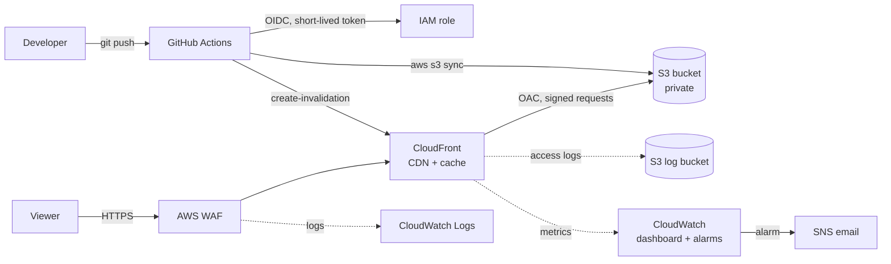

# Static Asset Delivery Platform

A global CDN for static assets, built entirely as code. Files live in a **private S3 bucket**, are served through **CloudFront** with **AWS WAF** in front, and are deployed by **GitHub Actions** using short-lived **OIDC credentials** (no stored AWS keys). Every deploy automatically **invalidates the CDN cache**.

**Stack:** AWS CloudFront · S3 · AWS WAF · Route 53 (optional) · ACM · IAM · CloudWatch · Terraform · GitHub Actions

**Live demo:** `https://d2c9xtaya35bhk.cloudfront.net ` *(add your URL, or note that the stack was torn down to save cost)*

---

## Architecture



**Two flows**

- **Request path:** viewer → WAF → CloudFront edge (cache hit returns immediately) → S3 only on a cache miss.
- **Deploy path:** push to `main` → GitHub Actions assumes an IAM role via OIDC → syncs `site/` to S3 with the right cache headers → invalidates the HTML paths in CloudFront.

---

## Features

| Area | What it does |
|---|---|
| **Private origin** | S3 bucket blocks all public access; only this CloudFront distribution can read it, via Origin Access Control (OAC) and a bucket policy scoped to the distribution ARN. |
| **Caching strategy** | Static assets get `Cache-Control: public, max-age=31536000, immutable`. HTML gets `max-age=60`. Uses the managed `CachingOptimized` policy with Brotli/Gzip compression. |
| **Security headers** | HSTS (preload), `X-Content-Type-Options`, `X-Frame-Options: DENY`, `Referrer-Policy`, XSS protection, and CORS via a response headers policy. |
| **TLS** | HTTPS enforced, HTTP redirected, TLS 1.2+ with a custom domain, HTTP/2 and HTTP/3 enabled. |
| **WAF** | Managed rule groups (Common, Known Bad Inputs, IP Reputation) plus a per-IP rate limit. Runs in **count mode** first, then switches to block. WAF logs go to CloudWatch. |
| **Custom errors** | 403/404 return a friendly `404.html`. |
| **Passwordless CI/CD** | GitHub OIDC with a least-privilege IAM role (S3 write + CloudFront invalidation only). |
| **Auto invalidation** | Each deploy invalidates `/index.html`, `/404.html` and `/*.html`. |
| **Observability** | CloudWatch dashboard (requests, error rates, bytes, WAF allowed vs blocked), alarms on 5xx rate and WAF block spikes, SNS email alerts. |
| **Optional custom domain** | One variable (`use_custom_domain`) adds an ACM certificate and Route 53 A/AAAA alias records. |
| **Versioning and lifecycle** | S3 versioning for rollback, old versions expire after 30 days, logs expire after 90 days. |

---

## Repository structure

```
.
├── .github/workflows/deploy.yml   # CI/CD: sync to S3 + invalidate CloudFront
├── site/                          # Static assets that get deployed
│   ├── index.html
│   ├── 404.html
│   └── assets/
├── terraform/
│   ├── versions.tf                # Providers (default region + us-east-1 alias)
│   ├── variables.tf
│   ├── locals.tf
│   ├── s3.tf                      # Origin bucket, log bucket, bucket policy
│   ├── cloudfront.tf              # Distribution, OAC, security headers
│   ├── waf.tf                     # Web ACL, rules, logging
│   ├── iam.tf                     # GitHub OIDC provider + deploy role
│   ├── monitoring.tf              # Dashboard, alarms, SNS
│   ├── acm.tf                     # Certificate (custom domain only)
│   ├── route53.tf                 # DNS records (custom domain only)
│   ├── outputs.tf
│   └── terraform.tfvars.example
└── README.md
```

---

## Prerequisites

- AWS account and the AWS CLI configured (`aws configure`)
- Terraform 1.5 or newer
- Git and a GitHub repository
- *(Optional)* a public Route 53 hosted zone if you want a custom domain

> ACM certificates and WAF web ACLs for CloudFront must be created in `us-east-1`. The Terraform here handles that with a provider alias.

---

## Deployment guide

### 1. Configure variables

```bash
cd terraform
cp terraform.tfvars.example terraform.tfvars
```

Edit `terraform.tfvars`:

```hcl
use_custom_domain = false                    # true = custom domain via Route 53

bucket_name = "your-unique-bucket-name"      # globally unique, lowercase
github_repo = "your-username/your-repo"
alarm_email = "you@example.com"

waf_count_mode = true                        # count first, block later
```

### 2. Create the infrastructure

```bash
terraform init
terraform validate
terraform plan
terraform apply
```

The first apply takes about 5-10 minutes, mostly waiting for CloudFront.

### 3. Confirm the alert email

AWS sends a subscription confirmation to `alarm_email`. Click **Confirm subscription**, otherwise alarms will not reach you.

### 4. Wire up GitHub Actions

In the repo go to **Settings → Secrets and variables → Actions → Variables** and add (values come from `terraform output`):

| Variable | Value |
|---|---|
| `S3_BUCKET` | `s3_bucket` output |
| `CF_DISTRIBUTION_ID` | `cloudfront_distribution_id` output |
| `AWS_ROLE_ARN` | `github_role_arn` output |

Then push a change under `site/` or run the workflow manually from the **Actions** tab.

### 5. Verify

```bash
# Cache: run twice, the second response should show "x-cache: Hit from cloudfront"
curl -I https://<your-url>/assets/app.js

# Security headers
curl -I https://<your-url>/

# Origin is private: direct S3 access should return 403
curl -I https://<bucket>.s3.<region>.amazonaws.com/index.html

# Custom 404 page
curl -I https://<your-url>/does-not-exist.html
```

---

## Caching strategy

| File type | `Cache-Control` | Why |
|---|---|---|
| Hashed or versioned assets (JS, CSS, images) | `public, max-age=31536000, immutable` | Never change under the same name, so cache for a year. |
| HTML | `public, max-age=60` | Short lifetime so updates appear quickly. |

If your build tool adds content hashes to filenames (for example `app.3f9a1c.js`), only HTML needs invalidating on each deploy. Invalidating `/*` on every deploy works but is wasteful.

---

## WAF rollout

Rules start in **count mode** (`waf_count_mode = true`) so nothing is blocked while you check the logs for false positives. After reviewing the CloudWatch log group `aws-waf-logs-<bucket_name>`:

```hcl
waf_count_mode = false
```

```bash
terraform apply
```

Then test the rate limit with a burst of requests (for example with `hey` or `ab`).

---

## Security design

- **No long-lived credentials.** GitHub gets a short-lived token through OIDC. No AWS access keys are stored in GitHub.
- **Least privilege.** The deploy role can only list, write and delete objects in this bucket and create invalidations on this distribution.
- **Role trust is pinned.** The role trusts only this repository (by its immutable repo ID) on the `main` branch.
- **Private bucket.** Public access is blocked and the bucket policy allows only CloudFront through OAC.
- **State and secrets stay out of git.** `.gitignore` excludes `*.tfstate`, `.terraform/` and `terraform.tfvars`.

---

## Troubleshooting and lessons learned

**`Not authorized to perform sts:AssumeRoleWithWebIdentity` even though the trust policy looked correct.**
Printing the real OIDC token claims inside the workflow showed that GitHub sends the `sub` claim with numeric IDs appended, for example:

```
repo:<owner>@<owner-id>/<repo>@<repo-id>:ref:refs/heads/main
```

instead of the commonly documented `repo:<owner>/<repo>:ref:refs/heads/main`. The role's trust condition did not match, and AWS returns the same generic error for any mismatch. Decoding the token (iss, aud, sub) with a short debug step made the cause obvious. The fix was to match the exact `sub` format in `terraform/iam.tf`.

> If you fork this project, update the `sub` value in `terraform/iam.tf` to match your own account and repository IDs. Print them with a debug step like the one used while building this.

**Other things worth knowing**

- `Credentials could not be loaded` from the AWS action means the role ARN input was empty. Check the variable name and that it was saved as a *repository variable*, not a secret.
- YAML indentation errors in `deploy.yml` make GitHub reject the whole workflow, so keep keys under `with:` aligned.
- WAF and ACM for CloudFront have to live in `us-east-1`, even if everything else is in another region.

---

## Cost notes

The CloudFront free tier covers a demo comfortably. WAF is the main cost: roughly a monthly fee for the web ACL plus a fee per rule and per request. A Route 53 hosted zone adds a small monthly charge if you use a custom domain. Origin Shield and Bot Control add more, so both are optional. Prices change, so check the AWS pricing pages and set a **budget alert** before deploying.

To stop all charges, empty both S3 buckets (including all object versions), then run:

```bash
terraform destroy
```

---

## Screenshots

*Add your own screenshots here:*

- [ ] Site served over HTTPS
- [ ] `x-cache: Hit from cloudfront` on the second request
- [ ] Security headers in the response
- [ ] Direct S3 URL returning 403
- [ ] Successful GitHub Actions run
- [ ] CloudWatch dashboard
- [ ] WAF rules and sampled requests

---

## Possible improvements

- Separate **staging** and **production** environments with their own buckets and distributions
- **Remote Terraform state** (S3 backend with locking) and `terraform plan` checks on pull requests
- **CloudFront Functions or Lambda@Edge** for URL rewrites and custom headers
- **Signed URLs or cookies** for private assets
- **Athena queries** over CloudFront and WAF logs
- Content-hashed filenames in the build so only HTML needs invalidating
- Tighter CORS origins and a Content-Security-Policy header for production use

---

## License

MIT
